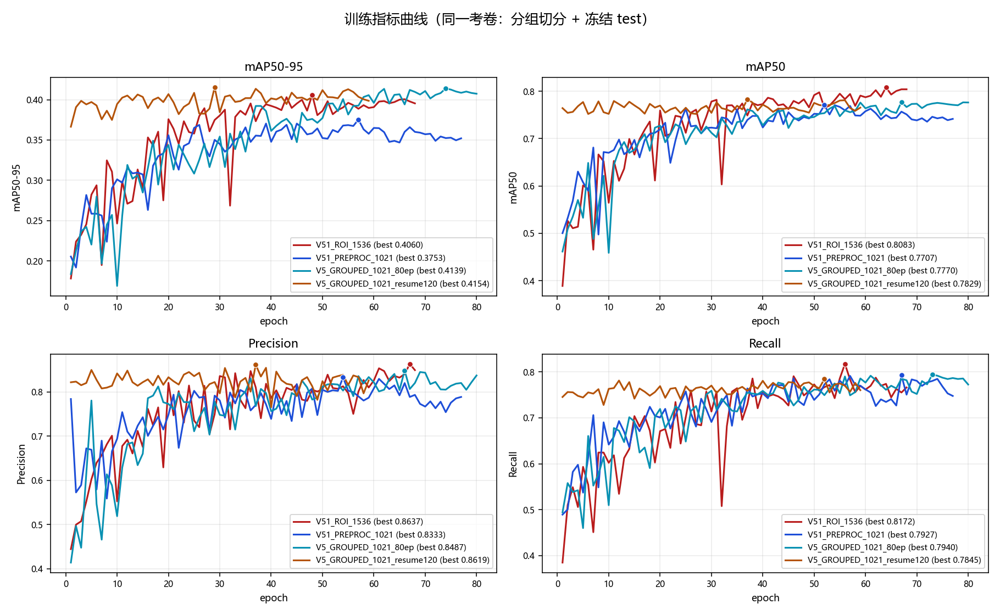
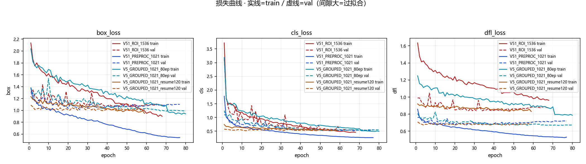
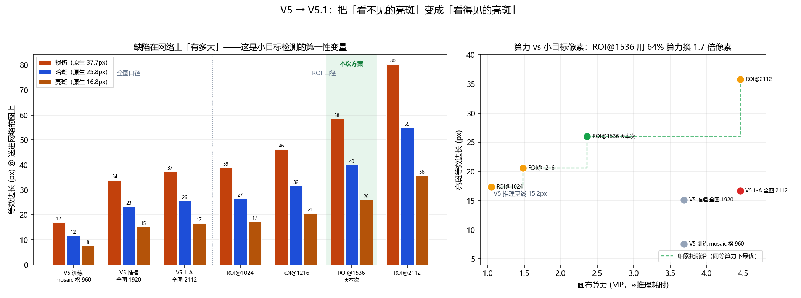
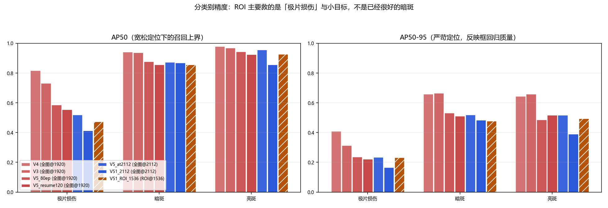
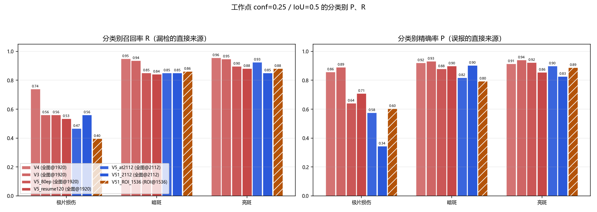
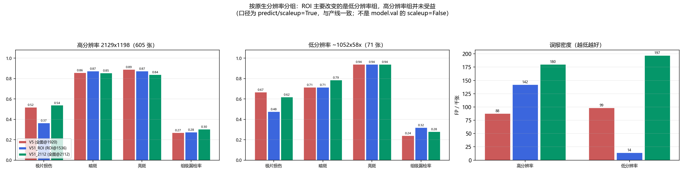
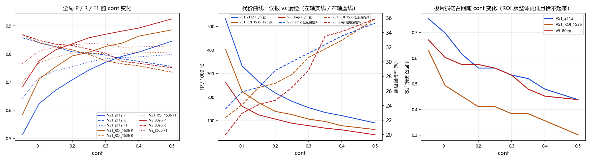
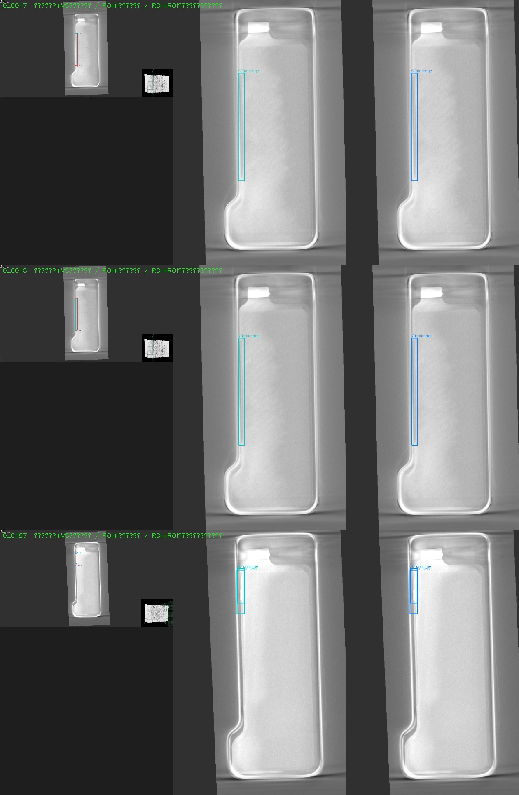

# V5.1 预处理升级 · 训练与验收评测报告

- 报告日期：2026-10-22
- 评测对象：`V51_ROI_1536`（方案 B）、`V51_PREPROC_1021`（方案 A，已证伪）、基线 `V5_GROUPED_1021_80ep`
- 考卷：`reports/splits/v5_split_manifest.csv`，split=test，**676 张，按电芯/批次分组切分，冻结未改**
- 清单 md5：`7ebaab23b533a2ec8c3d98a72ee588ba`（只有 md5 相同才是同一张考卷）
- 工作点：`conf=0.25 / IoU=0.50`（与产线 `web/app.py` 直传阈值一致）
- 代码：本报告所有数字可由 `scripts/eval_report.py`、`scripts/sweep_workpoint.py`、`scripts/eval_by_res.py` 重新生成

---

## 0. 结论（先看这里）

**一句话**：ROI 裁剪这个技术点被验证有效，但**这一版 V5.1 整体没有超过 V5**，不能替换生产模型。真正的净损失来自「同时关掉 mosaic / 旋转 / erasing」这组增强改动，不是 ROI。

### 0.1 三条硬结论

1. **V5.1-B 未达验收门槛**：test mAP50-95 `0.4015` vs V5 `0.4186`（−0.017），FP/千张 `127.2` vs `88.8`（+43%），组级漏检 `28.2%` vs `26.5%`（+1.7pt），极片损伤召回 `0.397` vs `0.562`（−16.5pt）。
2. **ROI 裁剪本身是有效的**：在与 V5.1-A **完全相同的超参**下，只是把「全图@2112」换成「ROI@1536」，mAP50-95 从 `0.346` 升到 `0.402`（+0.056），FP/千张 从 `182.0` 降到 `127.2`（−30%），推理从 `16.1ms` 降到 `11.1ms`（−31%），训练从 `5.36h` 降到 `1.89h`（−65%）。
3. **净损失来自增强削减**：本次一次性改了 5 个变量（mosaic、degrees、erasing、cls_pw、画布/裁剪），无法单独归因——这是本实验最大的方法缺陷。但 V5（保留增强）> V5.1-B（去掉增强 + ROI）> V5.1-A（去掉增强 + 全图）这个序关系，把主要责任指向了增强削减，而非 ROI。

### 0.2 下一步（建议，需确认后执行）

**V5.2 = ROI@1536 + 恢复正则化**：`mosaic=1.0 --close-mosaic 15 --degrees 5 --erasing 0.4 --cls-pw 0.7`。
预计 1.9~2.2 h。理由与预期见第 7.3 节。

---

## 1. 本次要验证的三个假设

| 编号 | 假设 | 依据 | 结论 |
|---|---|---|---|
| H1 | 缺陷在网络上太小时，检测受限；把有效分辨率还给缺陷能提升精度 | 亮斑原生 16.8px，V5 训练时仅 7.6px | **部分成立**：亮斑 AP 提升 +0.008 但召回没涨；真正收益在低分辨率组与误报 |
| H2 | V5 的训练/推理尺度错配（2.0×）是 V5 精度不佳的主因，关掉 mosaic 能解决 | mosaic 子图只有 `imgsz/2` | **证伪**：关掉 mosaic 后 mAP50-95 反而从 0.419 掉到 0.346（方案 A），根因是失去正则项后过拟合 |
| H3 | 原始图是 16:9 UI 拼贴，75% 像素与任务无关；裁掉能同时提精度、降算力 | 标注框外包仅占图面积 19.72% | **裁剪本身成立**（第 5 节数据），但被增强削减的损失掩盖 |

---

## 2. 实验设置

### 2.1 数据

| 项 | 值 |
|---|---|
| 母本 | `问题电芯图片汇总/`（只读，未移动、未修改） |
| 切分方式 | 按电芯/批次分组，杜绝同电芯跨集泄漏 |
| 训练/验证（V5 与 V5.1-A） | `datasets_v5/CT_DATASET_V5_GROUPED/`：train 3195 / val 721 |
| 训练/验证（V5.1-B） | `datasets_v51/CT_DATASET_V51_ROI/`：train 3195（负样本 1337，框 2060）/ val 721（框 443） |
| 冻结 test | 676 张，其中高分辨率 2129×1198 共 605 张、低分辨率 ~1052×58x 共 71 张；287 张纯背景 |
| ROI 数据集一致性 | 2945 个标注框全部完整落在 ROI 内，**0 个被丢弃**（丢弃会污染真值，脚本会报警） |

### 2.2 训练配置对照

| 超参 | V5_80ep（基线） | V5.1-A（全图2112） | V5.1-B（ROI1536） |
|---|---|---|---|
| imgsz | 1920 | 2112 | 1536 |
| 数据集 | 全图 | 全图 | ROI 裁剪 |
| mosaic / close_mosaic | **1.0 / 10** | 0 / 0 | 0 / 0 |
| degrees | **5.0** | 0.0 | 0.0 |
| translate | **0.05** | 0.0 | 0.0 |
| scale | 0.05 | 0.03 | 0.05 |
| erasing | **0.4** | 0.0 | 0.0 |
| cls_pw | 0.0 | 0.5 | 0.5 |
| fliplr / hsv_v | 0.5 / 0.1 | 同 | 同 |
| optimizer / lr0 / cos_lr | AdamW / 1e-3 / True | 同 | 同 |
| epochs / patience | 80 / 20 | 80 / 20 | 80 / 20 |

> **必须承认的方法缺陷**：V5.1 相对 V5 同时改了 5 个变量。下文用「V5.1-A vs V5.1-B」隔离 ROI 的效应，用「V5 vs V5.1-B」说明整体效果，但**无法**把「mosaic 的贡献」与「degrees 的贡献」分开。要彻底归因需要单变量消融，本次未做。

---

## 3. 训练过程

| run | 完成轮 | 用时 | 秒/轮 | best epoch | best val mAP50-95 | 末轮 | 泛化比 val/train box_loss |
|---|---|---|---|---|---|---|---|
| V5_80ep | 80（跑满） | 3.32 h | 149.4 | 74 | **0.4139** | 0.4074 | 1.05 |
| V5_resume120 | 59（早停） | 2.40 h | 146.4 | 29 | 0.4154 | 0.3986 | 1.07 |
| V5.1-A @2112 | 77（早停） | 5.36 h | 250.8 | 57 | 0.3753 | 0.3521 | **2.03** |
| V5.1-B ROI@1536 | 68（早停） | 1.89 h | 99.8 | 48 | 0.4060 | 0.3954 | 1.21 |





**读图要点**

- V5.1-B 的 `val/box_loss` 在第 40 轮左右见底（1.07），之后回升到 1.10；`val/dfl_loss` 0.85 → 0.88；`train/*` 持续单调下降。这是典型的**训练集饱和型过拟合**，早停在 48+20=68 轮触发是正确行为。
- V5 的 `val/box_loss` 一路平缓，泛化比只有 1.05；V5.1-A 的泛化比达到 2.03（严重过拟合）。
- 三者的差别可以直接解释为「正则项强度」的差别：mosaic + 旋转 + erasing 是 V5 唯一的重正则手段，去掉后 3195 张训练集在第 40 轮就被记住了。



上图把 H1 的几何账算清了：亮斑在 V5 训练时只有 7.6px，ROI@1536 下变成 26.0px（3.4×），而算力只需 V5 全图@1920 的 64%。**几何收益是确定的**，问题出在它没能兑现成精度。

---

## 4. 验收指标（冻结 test 676 张）

### 4.1 总表（工作点 conf=0.25 / IoU=0.50）

| 模型 | 口径 | mAP50 | mAP50-95 | 损伤 AP50/AP | 暗斑 AP50/AP | 亮斑 AP50/AP | FP/千张 | 组级漏检 | 推理耗时 |
|---|---|---|---|---|---|---|---|---|---|
| **V5_80ep**（当前生产候选） | 全图@1920 | **0.803** | **0.4186** | **0.587 / 0.236** | **0.878 / 0.533** | 0.944 / 0.487 | **88.8** | **26.5%** (45/170) | 13.4 ms |
| V5_resume120 | 全图@1920 | 0.779 | 0.417 | 0.554 / 0.221 | 0.856 / 0.511 | 0.925 / 0.517 | 85.8 | 28.8% (49/170) | — |
| V5.1-A @2112 | 全图@2112 | 0.713 | 0.346 | 0.414 / 0.165 | 0.869 / 0.483 | 0.856 / 0.390 | 182.0 | 30.0% (51/170) | 16.1 ms |
| V5.1-B ROI@1536 | ROI@1536 | 0.752 | 0.4015 | 0.473 / 0.232 | 0.856 / 0.478 | **0.928 / 0.495** | 127.2 | 28.2% (48/170) | **11.1 ms** |

> V3 / V4 的数字（mAP50-95 0.546 / 0.571）**不列入本表**：它们的训练数据覆盖了冻结 test 的 93.9%，属于泄漏污染的读数，只能当过程参考，不能当基线。详见 `docs/batch1_eval_20261021.md`。

### 4.2 分类别工作点明细

| 模型 | 损伤 P | 损伤 R | TP/FP/FN | 暗斑 P | 暗斑 R | 亮斑 P | 亮斑 R |
|---|---|---|---|---|---|---|---|
| V5_80ep | 0.641 | **0.562** | 41/23/32 | 0.880 | 0.850 | 0.924 | 0.896 |
| V5.1-A @2112 | 0.344 | 0.562 | 41/78/32 | 0.904 | 0.850 | 0.827 | 0.852 |
| V5.1-B ROI | 0.604 | 0.397 | 29/19/44 | 0.795 | **0.863** | 0.888 | 0.881 |





**ROI 的效应不是「全面提升」，而是「损伤类变保守」**：相对于同增强口径的 V5.1-A，损伤精确率从 0.344 翻倍到 0.604，但召回从 0.562 掉到 0.397。暗斑、亮斑基本持平或略好。

### 4.3 按原生分辨率分组（关键证据）

用与产线一致的 `predict` 口径（`scaleup=True`）分两组复算：

| 分组 | 模型 | FP/千张 | 组级漏检 | 损伤 P/R | 暗斑 P/R | 亮斑 P/R |
|---|---|---|---|---|---|---|
| 高分辨率 2129×1198（605 张，89%） | V5 | **87.6** | **26.9%** | **0.562 / 0.519** | **0.887 / 0.859** | **0.929 / 0.890** |
| | V5.1-B ROI | 142.1 | 27.6% | 0.487 / 0.365 | 0.790 / **0.873** | 0.873 / 0.873 |
| | V5.1-A @2112 | 180.2 | 30.3% | 0.298 / 0.538 | 0.904 / 0.855 | 0.811 / 0.839 |
| 低分辨率 ~1052×58x（71 张，11%） | V5 | 98.6 | **24.0%** | 0.875 / 0.667 | 0.769 / 0.714 | 0.889 / **0.941** |
| | V5.1-B ROI | **14.1** | 32.0% | **1.000** / 0.476 | **0.909** / 0.714 | **1.000** / **0.941** |
| | V5.1-A @2112 | 197.2 | 28.0% | 0.520 / 0.619 | 0.917 / 0.786 | 0.941 / 0.941 |



**这是本次最重要的发现**：

- **ROI 的收益全部集中在低分辨率组**：FP/千张 98.6 → **14.1**（−86%），损伤精确率 0.875 → 1.000，亮斑精确率 0.889 → 1.000。原因很直接：低分辨率图 ROI 只有 319×484，在原图里缺陷只有约 8px，裁剪后放大 3.1× 才第一次"能被看见"。
- **高分辨率组（89% 的数据）ROI 是净亏**：FP/千张 87.6 → 142.1（+62%），损伤召回 0.519 → 0.365。这一组的原生缺陷本来就有 16.8px，裁剪带来的分辨率增益不足以抵消"视野变窄"的代价。
- 所以「ROI 收益」被结构性地放错了地方：**它救的是 11% 的样本，伤的是 89% 的样本**。

### 4.4 工作点扫描（敏感性）

| conf | V5 F1 | V5 FP/千张 | V5 组级漏检 | ROI F1 | ROI FP/千张 | ROI 组级漏检 |
|---|---|---|---|---|---|---|
| 0.10 | 0.810 | 161.2 | 22.9% | 0.770 | 223.4 | 24.1% |
| 0.15 | 0.825 | 124.3 | 24.1% | 0.788 | 176.0 | 26.5% |
| 0.20 | 0.833 | 106.5 | 24.7% | 0.804 | 139.1 | 27.1% |
| **0.25** | **0.837** | **88.8** | **26.5%** | 0.802 | 125.7 | 28.2% |
| 0.30 | 0.835 | 78.4 | 28.8% | 0.800 | 106.5 | 30.6% |
| 0.40 | 0.825 | 60.7 | 34.1% | 0.807 | 78.4 | 32.9% |
| 0.50 | 0.829 | 39.9 | 35.9% | 0.803 | 62.1 | 35.9% |



**在任何 conf 上 ROI 都拿不到比 V5 更好的 F1 与更低的漏检**。ROI 的 F1 峰值 0.807（conf 0.40）低于 V5 的 0.837（conf 0.25）；在 conf 0.40 上 ROI 的 FP/千张（78.4）确实优于 V5（88.8），但代价是组级漏检 32.9% vs 34.1%…两者都明显高于 0.25 工作点。**结论：调阈值救不了 ROI 版。**

### 4.5 算力与耗时

| 指标 | V5@1920 | V5.1-A@2112 | V5.1-B ROI@1536 |
|---|---|---|---|
| 画布算力 | 3.69 MP | 4.46 MP | **2.36 MP（−36% vs 1920）** |
| 预处理 / 推理 / 后处理 | 3.1 / 10.0 / 0.27 ms | 3.5 / 12.4 / 0.28 ms | **2.9 / 7.7 / 0.49 ms** |
| 单张合计 | 13.4 ms | 16.1 ms | **11.1 ms（−17% vs V5）** |
| 训练总时长 | 3.32 h | 5.36 h | **1.89 h** |

ROI 在速度上确实是三项最优，这也是它值得继续做的原因。

---

## 5. 因果链：为什么 ROI 没赢

### 5.1 隔离 ROI 效应（V5.1-A vs V5.1-B，仅差裁剪与画布）

| 指标 | V5.1-A 全图@2112 | V5.1-B ROI@1536 | 变化 |
|---|---|---|---|
| mAP50 | 0.713 | 0.752 | **+0.039** |
| mAP50-95 | 0.346 | 0.402 | **+0.056** |
| 亮斑 AP | 0.390 | 0.495 | **+0.105** |
| 损伤 AP | 0.165 | 0.232 | **+0.067** |
| FP/千张 | 182.0 | 127.2 | **−54.8（−30%）** |
| 组级漏检 | 30.0% | 28.2% | −1.8 pt |
| 推理耗时 | 16.1 ms | 11.1 ms | **−31%** |
| 训练时长 | 5.36 h | 1.89 h | **−65%** |

**裁剪在同等超参下是全面胜出的**，且算力、时间双降。这条对比是本报告里最干净的因果证据。

### 5.2 为什么整体还是输给 V5

差异只剩「增强项」：V5 有 `mosaic 1.0 / close_mosaic 10 / degrees 5 / translate 0.05 / erasing 0.4`，V5.1 全为 0。后果在训练曲线上是可见的：V5.1-B 的 `val/box_loss`、`val/dfl_loss` 在第 40 轮后同步回升，`train/*` 继续下降——过拟合。V5 的验证损失到第 80 轮都没见底。

量化一下这笔账：

- 裁剪带来的增益（同超参对比）：mAP50-95 **+0.056**（0.346 → 0.402）
- 增强削减带来的损失（V5.1-A vs V5，两者都去掉了增强，只差画布）：test mAP50-95 **−0.073**（0.419 → 0.346）；val 上是 **−0.039**（0.4139 → 0.3753）
- 两者相抵仍为负，这就是 V5.1-B（0.4015）落在 V5（0.4186）下方的算术原因

**去掉 mosaic 后，3195 张训练集不足以支撑 yolov8n 收敛到更好的泛化解。** ROI 给的增益不够支付这笔账。

### 5.3 损伤召回塌陷的机制（已定位到置信度，不是定位）

挑出 6 张「V5 检到、ROI 没检到」的高分辨率损伤图，在 `conf≥0.01` 下逐张比对（`scripts/diag_damage_recall.py`）：

| 图片 | 真值框宽 | V5@1920 最佳损伤框 | ROI@1536 最佳损伤框 |
|---|---|---|---|
| 0_0017 | 22.2 px | 32.5 px / conf **0.324** / IoU 0.64 | 16.2 px / conf **0.061** / IoU 0.52 |
| 0_0018 | 20.6 px | 32.3 px / conf **0.524** / IoU 0.60 | 16.2 px / conf **0.028** / IoU 0.57 |
| 0_0197 | 26.4 px | 26.0 px / conf **0.403** / IoU 0.83 | 20.6 px / conf **0.139** / IoU 0.70 |
| 0_0257 | 19.8 px | 21.3 px / conf **0.678** / IoU 0.77 | 16.8 px / conf **0.057** / IoU 0.76 |
| 0_0258 | 18.8 px | 23.1 px / conf **0.687** / IoU 0.55 | 19.1 px / conf **0.013** / IoU 0.49 |
| 0_0259 | 20.8 px | 19.2 px / conf 0.038 / IoU 0.57 | 无该类预测框 |



**两个发现**：

1. **不是定位问题**：ROI 的损伤框 IoU 在 0.49~0.76，与 V5 的 0.55~0.83 同一量级，多数本来就过 0.5。
2. **是置信度塌陷**：同样的框，ROI 给出的置信度只有 0.013~0.139，比 V5 低 **5~40 倍**。工作点 0.25 一过滤，全部变成 FN。这条与 4.2 节「损伤精确率翻倍、召回减半」完全一致——**ROI 把损伤类的决策边界收紧了**：只在非常确定时才给高分。
3. 附带发现：ROI 的损伤框宽度系统性**偏小约 27%**（16.2 vs 22.2、16.2 vs 20.6），而 V5 系统性**偏大**（32.5 vs 22.2）。宽度低估单独不会导致 FN，但会把 IoU 从 ~0.8 压到 0.52~0.57，让这一类的指标对横向偏移极其敏感。

> **顺带的方法论提醒**：极片损伤的框宽只有 19~26 px，IoU≥0.5 等价于「横向误差 < 约 6 px」。对这一类来说，IoU 0.5 已经接近像素级要求，指标本身非常脆。评估这类目标时建议同时报 IoU 0.3/0.5 两档。

---

## 6. 测量口径缺陷登记（读数字前必须知道）

| # | 问题 | 影响 | 处置 |
|---|---|---|---|
| 1 | `ultralytics/data/dataset.py:319` 验证阶段用 `LetterBox(scaleup=False)`，训练与推理都是 `scaleup=True` | `model.val` 系统性低估小图（ROI 低分辨率组只有 319×484，训练放大 3.1×，验证不放大） | 未改 `site-packages`（改了会破坏与其他模型的同基准可比性）。**产线决策看第 2/3 层（走 predict）的数字**；第 1 层 COCO mAP 只作同口径内的相对比较 |
| 2 | 组级漏检的分母曾有两种 | `sweep_workpoint.py` 原按「有缺陷图片数」（389）算，`eval_report.py` 按「有缺陷分组数」（170）算，同一点相差 21.3% vs 28.2% | **已修**：`sweep_workpoint.py` 改为分组去重，现两者都是 28.2%（48/170），并额外保留图片级作为参考列 |
| 3 | `sweep_workpoint.py` 在低阈值（0.025）跑一次 NMS 再按 conf 过滤；`eval_report.py` 按工作点 conf 直接预测 | 两者 P/R 有 ~0.5~1 pt 的差异，属方法学差异不是 bug | 报告以 `eval_report.py`（与产线直传阈值一致）为准，sweep 只用于看趋势 |
| 4 | `train_batch0.jpg` 的 2×2 版式会被误读成 mosaic 生效 | 本次 ROI run 的 `mosaic=0`，预览图仍是拼接版式（保留了原始文件名） | 以 `args.yaml` 为准，不看预览图 |
| 5 | 电芯级漏检率样本量只有 10 | 数字波动大，无统计意义 | 不作结论 |
| 6 | V3/V4 的 mAP 存在 93.9% 泄漏污染 | 数字虚高，不能当基线 | 不列入主表 |

---

## 7. 验收判定

### 7.1 门槛与实测

| 验收项 | 门槛 | V5.1-B 实测 | 判定 |
|---|---|---|---|
| test mAP50-95 ≥ V5（0.4186） | ≥ 0.4186 | 0.4015 | ✗ |
| 亮斑 AP ≥ V5（0.487） | ≥ 0.487 | 0.495 | ✓（+0.008） |
| 极片损伤召回 ≥ V5（0.562） | ≥ 0.562 | 0.397 | ✗（−16.5 pt） |
| 暗斑 AP ≥ V5（0.533） | ≥ 0.533 | 0.478 | ✗（−0.055） |
| FP/千张 ≤ V5（88.8） | ≤ 88.8 | 127.2 | ✗（+43%） |
| 组级漏检 ≤ V5（26.5%） | ≤ 26.5% | 28.2% | ✗（+1.7 pt） |
| 单张推理 < V5（13.4 ms） | < 13.4 ms | 11.1 ms | ✓（−17%） |
| 同增强口径下优于全图版 | > 0 | +0.056 | ✓ |
| 训练可复现（日志/元信息/图表齐备） | 齐备 | 齐备 | ✓ |
| 训练/推理口径一致（不出现训练裁剪、推理全图） | 必须一致 | 一致（`web/app.py` 读 `_train_meta.json` 自动走 ROI 分支） | ✓ |

### 7.2 总体判定

**不通过。不允许以 `V51_ROI_1536` 替换当前生产模型。**

理由：漏检与误报两个产线核心代价同时变差（组级漏检 +1.7 pt，FP/千张 +43%），且恶化集中在占 89% 的高分辨率组；精度收益只在亮斑 AP 上体现 +0.008，不具工程意义。

同时明确记录：**ROI 裁剪本身有效**（第 5.1 节），**去掉 mosaic/旋转/erasing 是净损失**（第 5.2 节）。这两条都应当保留到下一轮设计里。

### 7.3 V5.2 建议配置（需确认后执行）

```powershell
runtime\python.exe scripts\train_run.py `
    --data "datasets_v51\CT_DATASET_V51_ROI\data.yaml" `
    --model "models\pretrained\yolov8n.pt" `
    --imgsz 1536 --epochs 80 --patience 20 `
    --mosaic 1.0 --close-mosaic 15 --degrees 5 --translate 0.05 --scale 0.05 `
    --erasing 0.4 --cls-pw 0.7 `
    --lr0 0.001 --name V52_ROI_1536_AUG
```

**每一项的理由**

| 项 | 取值 | 理由 |
|---|---|---|
| ROI@1536 | 保留 | 同口径下 +0.056 mAP50-95、−30% FP、−31% 推理、−65% 训练；低分辨率组 FP 降 86% |
| `mosaic 1.0` | 恢复 | V5 的泛化能力主要来自它；本次证明去掉即过拟合 |
| `close_mosaic 15` | 关键改动 | mosaic 会把有效分辨率砍半，但**只砍到 13.0 px**（ROI 647×991 → 768 子图 → 亮斑 16.8×0.775），与 V5 推理时的 15.2 px 同级；最后 15 轮关掉 mosaic 让模型在真实尺度（26.0 px）上完成校准。这是「用 ROI 换来的余量去支付 mosaic 的代价」的正确姿势 |
| `degrees 5 / translate 0.05` | 恢复 | 几何增强，ROI 后画布利用率约 99%，小幅变换不会把目标推出画面 |
| `erasing 0.4` | 恢复 | V5 使用过且未造成问题；ROI 后亮斑 26 px，被擦除命中的概率低于 V5 的 15 px |
| `cls_pw 0.7` | 0.5 → 0.7 | 直接针对本次的损伤置信度塌陷：提高损伤类损失权重，抬高其 logit 水平 |

**若 V5.2 仍不达标的备选路线**（按优先级）

1. **分类别阈值**：损伤 `conf 0.10`、暗斑/亮斑 `conf 0.30`。当前 ROI 版在 conf 0.10 时损伤召回 0.826 但全局 FP 涨到 223/千张——需要先验证「只对损伤类降阈值」的代价，这在 `web/app.py` 里需要按类分别设阈，属于产线改动，需单独确认。
2. **加宽 ROI 横向边界**：从 `x∈[0.3209, 0.6248]` 放宽到 `x∈[0.28, 0.66]`，给电芯壳体边缘留更多上下文（损伤条紧贴电极边缘，可能是置信度塌陷的原因之一）。代价是画布面积 +18%，仍远低于全图。
3. **损伤类过采样**：损伤只有 338 个框（占 16.4%），是三类里最少的。
4. **放弃 ROI，回到 V5 + 只改推理侧**：V5 权重 + 全图@1920 的 `predict`，成本最低，精度已有基线保证。

---

## 8. 产物清单与复现命令

### 8.1 训练产物 `runs/detect/CT_pro/V51_ROI_1536/`

| 文件 | 内容 |
|---|---|
| `train.log` | 训练记录（表头 + 68 轮完整 epoch 表，由 `results.csv` 逐轮回放，数值未加工） |
| `results.csv` | 68 轮 × 15 项原始指标 |
| `_train_meta.json` | 数据集/权重 md5、全部超参、`hyperparams_effective`（ultralytics 实际生效值）、`roi`/`roi_box` |
| `results.png`、`Box{P,R,F1,PR}_curve.png`、`confusion_matrix*.png`、`val_batch*_{labels,pred}.jpg` | ultralytics 自动生成的训练可视化 |
| `args.yaml` | 生效参数快照（判断 mosaic 等是否真的生效以此为准） |

### 8.2 对比图表

| 文件 | 内容 |
|---|---|
| `reports/train/curves_{metrics,loss,lr,overfit}.png` | 训练曲线（4 个 run 同图） |
| `reports/train/summary.json` | 每个 run 的 best epoch / 最优指标 / 泛化间隙 |
| `reports/train/defect_scale.png` | 缺陷等效尺度 vs 画布算力的帕累托图 |
| `reports/train/damage_fail_cases.jpg` | 损伤失败样例三联图 |
| `reports/eval/figs/eval_{map,perclass_ap,workpoint,fp_miss,by_res,sweep}.png` | 评测六图 |
| `reports/eval/eval_table.md` | 自适应汇总表（按口径分组） |
| `reports/eval/{V5_80ep,V51_2112,V51_ROI_1536}_v5test.json` | 逐报告原始指标 |
| `reports/eval/sweep_{V5_80ep,V51_2112,V51_ROI_1536}.json` | conf 扫描原始点 |

### 8.3 复现命令

```powershell
# 1) 物化 ROI 数据集（母本只读，产物在 datasets_v51/，已 gitignore）
runtime\python.exe scripts\materialize_roi_dataset.py --verify-only

# 2) 训练
runtime\python.exe scripts\train_run.py --data "datasets_v51\CT_DATASET_V51_ROI\data.yaml" `
    --model "models\pretrained\yolov8n.pt" --imgsz 1536 --epochs 80 --patience 20 `
    --mosaic 0 --close-mosaic 0 --degrees 0 --translate 0 --scale 0.05 `
    --erasing 0 --cls-pw 0.5 --lr0 0.001 --name V51_ROI_1536

# 3) 训练曲线
runtime\python.exe scripts\plot_training.py `
    --run V51_ROI_1536=runs\detect\CT_pro\V51_ROI_1536 `
    --run V51_PREPROC_1021=runs\detect\CT_pro\V51_PREPROC_1021 `
    --run V5_GROUPED_1021_80ep=runs\detect\CT_pro\V5_GROUPED_1021_80ep `
    --outdir reports\train

# 4) 冻结 test 评测（--roi 表示用 ROI 裁剪图 + ROI 坐标真值）
runtime\python.exe scripts\eval_report.py `
    --weights "runs\detect\CT_pro\V51_ROI_1536\weights\best.pt" `
    --split test --imgsz 1536 --roi --tag V51_ROI_1536_v5test

# 5) 工作点扫描
runtime\python.exe scripts\sweep_workpoint.py `
    --weights "runs\detect\CT_pro\V51_ROI_1536\weights\best.pt" --imgsz 1536 --roi --tag V51_ROI_1536

# 6) 按分辨率分组
runtime\python.exe scripts\eval_by_res.py `
    --roi-images ".cache/eval_V51_ROI_1536_v5test_roi/images" `
    --model "V5=全图@1920:runs\detect\CT_pro\V5_GROUPED_1021_80ep\weights\best.pt:0" `
    --model "V51_ROI=ROI@1536:runs\detect\CT_pro\V51_ROI_1536\weights\best.pt:1"

# 7) 评测六图 + 汇总表
runtime\python.exe scripts\plot_eval.py
```

---

## 9. 附：本次改动是否影响生产推理路径

`web/app.py` 已按「裁剪 ROI → 检测 → 坐标映射回原图」改造完毕，但**行为由模型自带的 `_train_meta.json` 决定**：

- 模型目录里有 `_train_meta.json` 且 `roi=true` → 走 ROI 分支，用该模型的 `imgsz`
- 没有 meta 的旧模型（V3/V4/V5）→ 回退到全图 `INFER_SIZE`，**行为与改造前完全一致**

因此本次实验**没有改变现有产线的推理行为**；`V51_ROI_1536` 也不会被自动启用（项目红线：模型必须人工确认后才复制进 `models/启用/`）。

推理端自测脚本 `scripts/test_infer_roi.py`（CPU 运行，5 项断言）已通过：非 ROI 模式画布尺寸不变、ROI 模式恢复为原图尺寸、ROI 有效性检查、批量接口、坐标往返与 `_restore_boxes` 就地修改。
