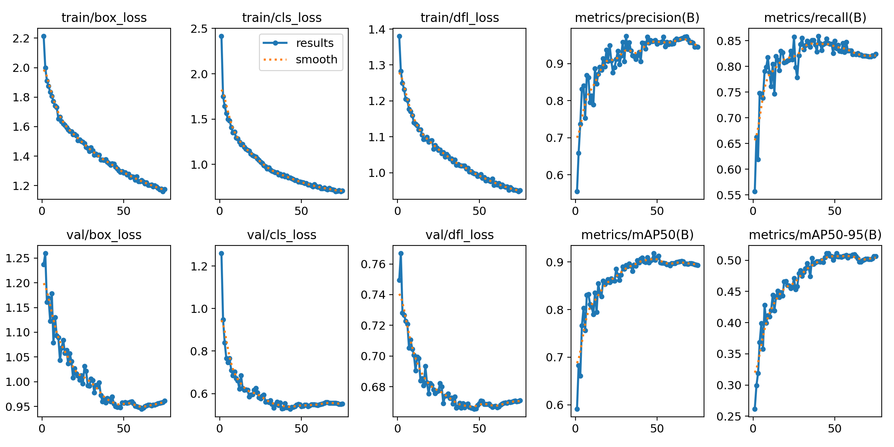

# `CT_DATASET_FINAL_V4_AUG_1016_1616` 训练结果与分析

> 本文件由 `scripts/archive_experiment.py` 依据 `runs/detect/CT_pro/CT_DATASET_FINAL_V4_AUG_1016_1616/` 与 `reports/eval/` 的真实文件生成，数字未经人工改写。
> 生成时间：2026-10-22 12:53

## 1. 配置

| 项 | 值 |
|---|---|
| 数据集 | `datasets\CT_DATASET_FINAL_V4_AUG\data.yaml` |
| 初始化权重 | `models/pretrained\yolov8n.pt` |
| 画布 imgsz | `1920` |
| 计划轮数 | `300` |
| batch | `0.75` |
| 优化器 | `AdamW` |
| lr0 | `0.001` |
| patience | `30` |

**数据增强（ultralytics 实际生效值）**

| mosaic | close_mosaic | degrees | translate | scale | shear | perspective | flipud | fliplr | hsv_h | hsv_s | hsv_v | erasing | copy_paste | mixup | cutmix | cls_pw |
|---|---|---|---|---|---|---|---|---|---|---|---|---|---|---|---|---|
| 1.0 | 10 | 5.0 | 0.05 | 0.05 | 0.0 | 0.0 | 0.0 | 0.5 | 0.0 | 0.0 | 0.1 | 0.4 | 0.0 | 0.0 | 0.0 | 0.0 |

## 2. 训练过程

| 项 | 值 |
|---|---|
| 实际完成轮数 | 75 / 300（早停） |
| 最优 epoch | 45 |
| 最优 mAP50 / mAP50-95 | 0.8984 / **0.5112** |
| 总训练时长 | 11.97 h（574.4 s/epoch） |
| 末轮 train / val box_loss | 1.176 / 0.961 |
| 泛化间隙 (val-train)/train | -18.3% |

## 5. 结论与判断（人工填写）

<!-- ARCHIVE-NOTES-START -->
_待补充：本 run 相对基线的净收益/净损失、可信度、是否可上线、遗留风险。_
<!-- ARCHIVE-NOTES-END -->

## 6. 产物清单

| 目录 | 内容 |
|---|---|
| `01_train/` | args.yaml、results.csv、results.png、曲线、混淆矩阵、batch 预览、train.log、`_train_meta.json` |
| `02_eval/` | 冻结 test 报告 JSON、conf 扫描 JSON、单 run 概览图 |
| `00_meta.json` | 本 run 的结构化摘要（供脚本与索引消费） |
| `weights/` | 不复制；见 `weights.txt` 记录的原路径与 md5 |
