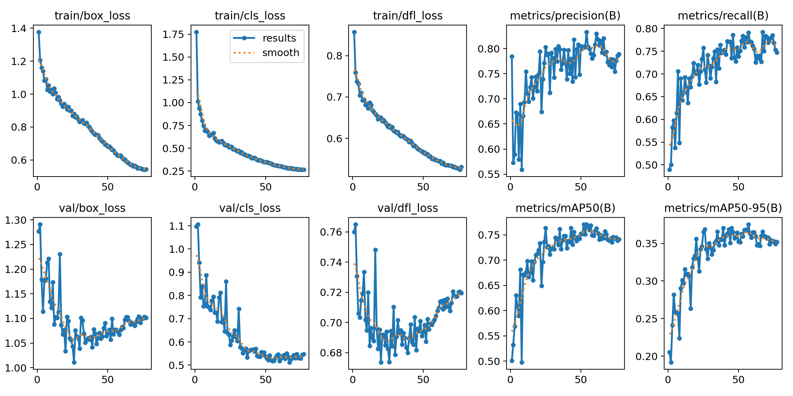
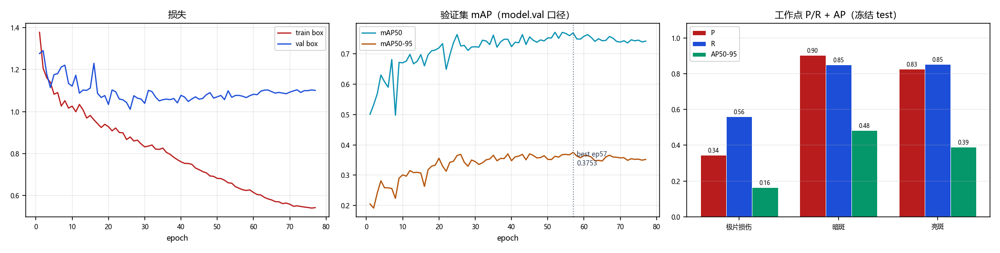

# `V51_PREPROC_1021` 训练结果与分析

> 本文件由 `scripts/archive_experiment.py` 依据 `runs/detect/CT_pro/V51_PREPROC_1021/` 与 `reports/eval/` 的真实文件生成，数字未经人工改写。
> 生成时间：2026-10-22 12:53

## 1. 配置

| 项 | 值 |
|---|---|
| 数据集 | `datasets_v5/CT_DATASET_V5_GROUPED/data.yaml` |
| 初始化权重 | `models/pretrained/yolov8n.pt` |
| 画布 imgsz | `2112` |
| 计划轮数 | `80` |
| batch | `0.75` |
| 优化器 | `AdamW` |
| lr0 | `0.001` |
| patience | `20` |

**数据增强（ultralytics 实际生效值）**

| mosaic | close_mosaic | degrees | translate | scale | shear | perspective | flipud | fliplr | hsv_h | hsv_s | hsv_v | erasing | copy_paste | mixup | cutmix | cls_pw |
|---|---|---|---|---|---|---|---|---|---|---|---|---|---|---|---|---|
| 0.0 | 0 | 0.0 | 0.0 | 0.03 | 0.0 | 0.0 | 0.0 | 0.5 | 0.0 | 0.0 | 0.1 | 0.0 | 0.0 | 0.0 | 0.0 | 0.5 |

## 2. 训练过程

| 项 | 值 |
|---|---|
| 实际完成轮数 | 77 / 80（早停） |
| 最优 epoch | 57 |
| 最优 mAP50 / mAP50-95 | 0.7690 / **0.3753** |
| 总训练时长 | 5.36 h（250.8 s/epoch） |
| 末轮 train / val box_loss | 0.543 / 1.101 |
| 泛化间隙 (val-train)/train | +102.9% |

## 3. 冻结 test 评测

口径：`全图@2112`（layer1 走 model.val，固定 conf=0.001）；工作点 conf=0.25 / IoU=0.5。

| 报告 | mAP50 | mAP50-95 | FP/千张 | 组级漏检 | 单张耗时 |
|---|---|---|---|---|---|
| `V51_2112_v5test` | 0.7129 | 0.3461 | 182.0 | 51/170 (30.00%) | 16.1 ms |

**分类别（工作点 P/R + AP）**

| 类别 | AP50 | AP50-95 | P | R | TP | FP | FN |
|---|---|---|---|---|---|---|---|
| 极片损伤 | 0.4141 | 0.1647 | 0.3445 | 0.5616 | 41 | 78 | 32 |
| 暗斑 | 0.8689 | 0.4833 | 0.9045 | 0.8504 | 199 | 21 | 35 |
| 亮斑 | 0.8557 | 0.3904 | 0.8273 | 0.8519 | 115 | 24 | 20 |

电芯级漏检（抽样 n=10）：40%

## 4. 工作点扫描（conf 敏感度）

| conf | P | R | F1 | FP/千张 | 组级漏检 |
|---|---|---|---|---|---|
| 0.05 | 0.5129 | 0.8575 | 0.6418 | 532.5 | 23.53% |
| 0.10 | 0.6231 | 0.8416 | 0.7161 | 332.8 | 25.88% |
| 0.15 | 0.6710 | 0.8258 | 0.7404 | 264.8 | 26.47% |
| 0.20 | 0.7083 | 0.8077 | 0.7548 | 217.5 | 28.82% |
| 0.25 | 0.7427 | 0.8032 | 0.7717 | 182.0 | 30.00% |
| 0.30 | 0.7702 | 0.7964 | 0.7831 | 155.3 | 31.18% |
| 0.35 | 0.7918 | 0.7828 | 0.7873 | 134.6 | 32.35% |
| 0.40 | 0.8066 | 0.7738 | 0.7898 | 121.3 | 33.53% |
| 0.50 | 0.8456 | 0.7557 | 0.7981 | 90.2 | 35.29% |

## 5. 结论与判断（人工填写）

<!-- ARCHIVE-NOTES-START -->
_待补充：本 run 相对基线的净收益/净损失、可信度、是否可上线、遗留风险。_
<!-- ARCHIVE-NOTES-END -->

## 6. 产物清单

| 目录 | 内容 |
|---|---|
| `01_train/` | args.yaml、results.csv、results.png、曲线、混淆矩阵、batch 预览、train.log、`_train_meta.json` |
| `02_eval/` | 冻结 test 报告 JSON、conf 扫描 JSON、单 run 概览图 |
| `00_meta.json` | 本 run 的结构化摘要（供脚本与索引消费） |
| `weights/` | 不复制；见 `weights.txt` 记录的原路径与 md5 |
