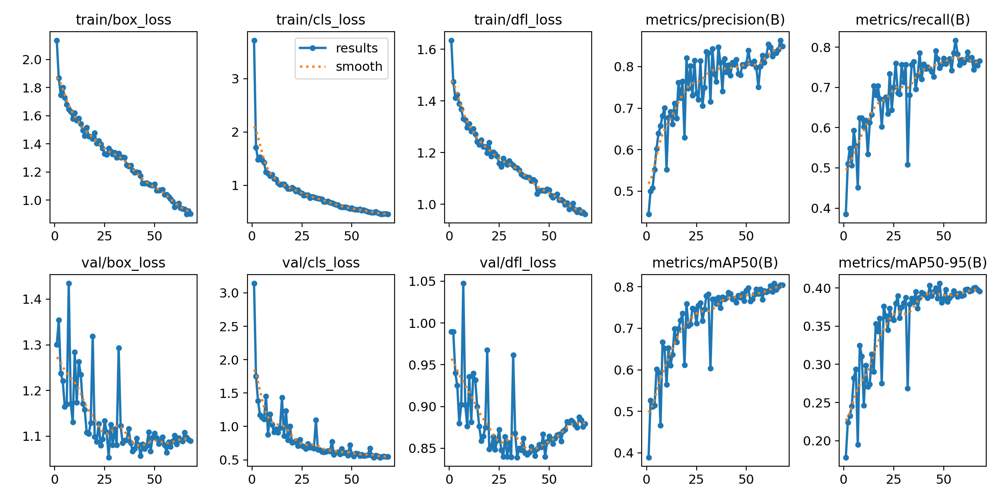
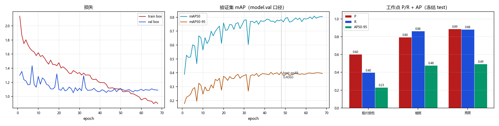

# `V51_ROI_1536` 训练结果与分析

> 本文件由 `scripts/archive_experiment.py` 依据 `runs/detect/CT_pro/V51_ROI_1536/` 与 `reports/eval/` 的真实文件生成，数字未经人工改写。
> 生成时间：2026-10-22 12:53

## 1. 配置

| 项 | 值 |
|---|---|
| 数据集 | `datasets_v51/CT_DATASET_V51_ROI/data.yaml` |
| 初始化权重 | `models/pretrained/yolov8n.pt` |
| 画布 imgsz | `1536` |
| 计划轮数 | `80` |
| batch | `0.75` |
| 优化器 | `AdamW` |
| lr0 | `0.001` |
| patience | `20` |
| ROI 裁剪 | 是，box={'x0': 0.3209, 'x1': 0.6248, 'y0': 0.1181, 'y1': 0.9446} |

**数据增强（ultralytics 实际生效值）**

| mosaic | close_mosaic | degrees | translate | scale | shear | perspective | flipud | fliplr | hsv_h | hsv_s | hsv_v | erasing | copy_paste | mixup | cutmix | cls_pw |
|---|---|---|---|---|---|---|---|---|---|---|---|---|---|---|---|---|
| 0.0 | 0 | 0.0 | 0.0 | 0.05 | 0.0 | 0.0 | 0.0 | 0.5 | 0.0 | 0.0 | 0.1 | 0.0 | 0.0 | 0.0 | 0.0 | 0.5 |

## 2. 训练过程

| 项 | 值 |
|---|---|
| 实际完成轮数 | 68 / 80（早停） |
| 最优 epoch | 48 |
| 最优 mAP50 / mAP50-95 | 0.7829 / **0.4060** |
| 总训练时长 | 1.89 h（99.8 s/epoch） |
| 末轮 train / val box_loss | 0.901 / 1.090 |
| 泛化间隙 (val-train)/train | +21.0% |

## 3. 冻结 test 评测

口径：`ROI@1536`（layer1 走 model.val，固定 conf=0.001）；工作点 conf=0.25 / IoU=0.5。

| 报告 | mAP50 | mAP50-95 | FP/千张 | 组级漏检 | 单张耗时 |
|---|---|---|---|---|---|
| `V51_ROI_1536_v5test` | 0.7522 | 0.4015 | 127.2 | 48/170 (28.24%) | 11.1 ms |

**分类别（工作点 P/R + AP）**

| 类别 | AP50 | AP50-95 | P | R | TP | FP | FN |
|---|---|---|---|---|---|---|---|
| 极片损伤 | 0.4727 | 0.2321 | 0.6042 | 0.3973 | 29 | 19 | 44 |
| 暗斑 | 0.8559 | 0.4779 | 0.7953 | 0.8632 | 202 | 52 | 32 |
| 亮斑 | 0.9280 | 0.4947 | 0.8881 | 0.8815 | 119 | 15 | 16 |

电芯级漏检（抽样 n=10）：50%

## 4. 工作点扫描（conf 敏感度）

| conf | P | R | F1 | FP/千张 | 组级漏检 |
|---|---|---|---|---|---|
| 0.05 | 0.5845 | 0.8688 | 0.6988 | 403.8 | 22.35% |
| 0.10 | 0.7107 | 0.8394 | 0.7697 | 223.4 | 24.12% |
| 0.15 | 0.7541 | 0.8258 | 0.7883 | 176.0 | 26.47% |
| 0.20 | 0.7930 | 0.8145 | 0.8036 | 139.1 | 27.06% |
| 0.25 | 0.8059 | 0.7986 | 0.8023 | 125.7 | 28.24% |
| 0.30 | 0.8265 | 0.7760 | 0.8005 | 106.5 | 30.59% |
| 0.35 | 0.8387 | 0.7647 | 0.8000 | 96.2 | 31.76% |
| 0.40 | 0.8634 | 0.7579 | 0.8072 | 78.4 | 32.94% |
| 0.50 | 0.8856 | 0.7353 | 0.8035 | 62.1 | 35.88% |

## 5. 结论与判断（人工填写）

<!-- ARCHIVE-NOTES-START -->
_待补充：本 run 相对基线的净收益/净损失、可信度、是否可上线、遗留风险。_
<!-- ARCHIVE-NOTES-END -->

## 6. 产物清单

| 目录 | 内容 |
|---|---|
| `01_train/` | args.yaml、results.csv、results.png、曲线、混淆矩阵、batch 预览、train.log、`_train_meta.json` |
| `02_eval/` | 冻结 test 报告 JSON、conf 扫描 JSON、单 run 概览图 |
| `00_meta.json` | 本 run 的结构化摘要（供脚本与索引消费） |
| `weights/` | 不复制；见 `weights.txt` 记录的原路径与 md5 |
