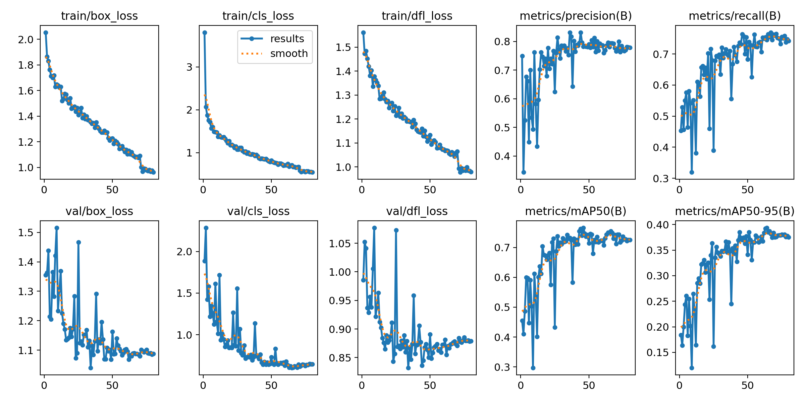
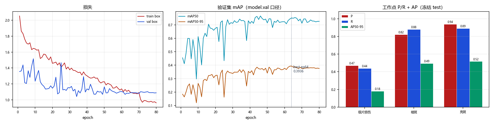

# `V52_ROI_1536_REG` 训练结果与分析

> 本文件由 `scripts/archive_experiment.py` 依据 `runs/detect/CT_pro/V52_ROI_1536_REG/` 与 `reports/eval/` 的真实文件生成，数字未经人工改写。
> 生成时间：2026-10-22 15:14

## 1. 配置

| 项 | 值 |
|---|---|
| 数据集 | `datasets_v51/CT_DATASET_V51_ROI/data.yaml` |
| 初始化权重 | `models/pretrained/yolov8n.pt` |
| 画布 imgsz | `1536` |
| 计划轮数 | `80` |
| batch | `0.75` |
| 优化器 | `AdamW` |
| lr0 | `0.001` |
| patience | `20` |
| ROI 裁剪 | 是，box={'x0': 0.3209, 'x1': 0.6248, 'y0': 0.1181, 'y1': 0.9446} |

**数据增强（ultralytics 实际生效值）**

| mosaic | close_mosaic | degrees | translate | scale | shear | perspective | flipud | fliplr | hsv_h | hsv_s | hsv_v | erasing | copy_paste | mixup | cutmix | cls_pw |
|---|---|---|---|---|---|---|---|---|---|---|---|---|---|---|---|---|
| 1.0 | 10 | 5.0 | 0.05 | 0.05 | 0.0 | 0.0 | 0.0 | 0.5 | 0.0 | 0.0 | 0.1 | 0.4 | 0.0 | 0.0 | 0.0 | 0.0 |

## 2. 训练过程

| 项 | 值 |
|---|---|
| 实际完成轮数 | 80 / 80 |
| 最优 epoch | 64 |
| 最优 mAP50 / mAP50-95 | 0.7506 / **0.3936** |
| 总训练时长 | 2.16 h（97.3 s/epoch） |
| 末轮 train / val box_loss | 0.962 / 1.088 |
| 泛化间隙 (val-train)/train | +13.1% |

## 3. 冻结 test 评测

口径：`ROI@1536`（layer1 走 model.val，固定 conf=0.001）；工作点 conf=0.25 / IoU=0.5。

| 报告 | mAP50 | mAP50-95 | FP/千张 | 组级漏检 | 单张耗时 |
|---|---|---|---|---|---|
| `V52_ROI_1536_REG_v5test` | 0.7600 | 0.3977 | 131.7 | 49/170 (28.82%) | 10.4 ms |

**分类别（工作点 P/R + AP）**

| 类别 | AP50 | AP50-95 | P | R | TP | FP | FN |
|---|---|---|---|---|---|---|---|
| 极片损伤 | 0.4530 | 0.1813 | 0.4706 | 0.4384 | 32 | 36 | 41 |
| 暗斑 | 0.8804 | 0.4950 | 0.8207 | 0.8803 | 206 | 45 | 28 |
| 亮斑 | 0.9467 | 0.5168 | 0.9375 | 0.8889 | 120 | 8 | 15 |

电芯级漏检（抽样 n=10）：30%

## 4. 工作点扫描（conf 敏感度）

| conf | P | R | F1 | FP/千张 | 组级漏检 |
|---|---|---|---|---|---|
| 0.05 | 0.5841 | 0.8643 | 0.6971 | 402.4 | 19.41% |
| 0.10 | 0.6893 | 0.8484 | 0.7606 | 250.0 | 22.35% |
| 0.15 | 0.7399 | 0.8303 | 0.7825 | 190.8 | 25.88% |
| 0.20 | 0.7747 | 0.8167 | 0.7952 | 155.3 | 27.65% |
| 0.25 | 0.8009 | 0.8100 | 0.8054 | 131.7 | 28.82% |
| 0.30 | 0.8218 | 0.8032 | 0.8124 | 113.9 | 30.59% |
| 0.35 | 0.8486 | 0.7986 | 0.8228 | 93.2 | 31.18% |
| 0.40 | 0.8715 | 0.7828 | 0.8248 | 75.4 | 34.71% |
| 0.50 | 0.9022 | 0.7511 | 0.8198 | 53.3 | 38.82% |

## 5. 结论与判断（人工填写）

<!-- ARCHIVE-NOTES-START -->
_待补充：本 run 相对基线的净收益/净损失、可信度、是否可上线、遗留风险。_
<!-- ARCHIVE-NOTES-END -->

## 6. 产物清单

| 目录 | 内容 |
|---|---|
| `01_train/` | args.yaml、results.csv、results.png、曲线、混淆矩阵、batch 预览、train.log、`_train_meta.json` |
| `02_eval/` | 冻结 test 报告 JSON、conf 扫描 JSON、单 run 概览图 |
| `00_meta.json` | 本 run 的结构化摘要（供脚本与索引消费） |
| `weights/` | 不复制；见 `weights.txt` 记录的原路径与 md5 |
