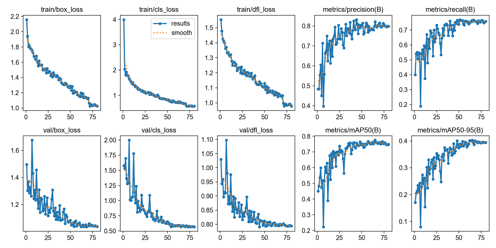
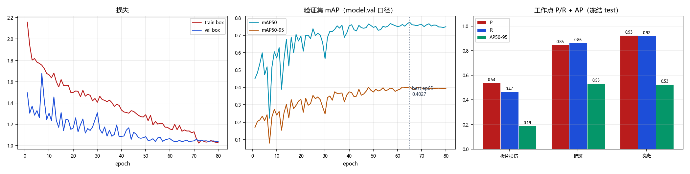

# `V53_ROI_M15` 训练结果与分析

> 本文件由 `scripts/archive_experiment.py` 依据 `runs/detect/CT_pro/V53_ROI_M15/` 与 `reports/eval/` 的真实文件生成，数字未经人工改写。
> 生成时间：2026-10-23 03:15

## 1. 配置

| 项 | 值 |
|---|---|
| 数据集 | `datasets_v51/CT_DATASET_V51_ROI_M15/data.yaml` |
| 初始化权重 | `models\pretrained\yolov8n.pt` |
| 画布 imgsz | `1536` |
| 计划轮数 | `80` |
| batch | `0.75` |
| 优化器 | `AdamW` |
| lr0 | `0.001` |
| patience | `20` |
| ROI 裁剪 | 是，box={'x0': 0.3209, 'x1': 0.6248, 'y0': 0.1181, 'y1': 0.9446} |

**数据增强（ultralytics 实际生效值）**

| mosaic | close_mosaic | degrees | translate | scale | shear | perspective | flipud | fliplr | hsv_h | hsv_s | hsv_v | erasing | copy_paste | mixup | cutmix | cls_pw |
|---|---|---|---|---|---|---|---|---|---|---|---|---|---|---|---|---|
| 1.0 | 10 | 5.0 | 0.05 | 0.05 | 0.0 | 0.0 | 0.0 | 0.5 | 0.0 | 0.0 | 0.1 | 0.4 | 0.0 | 0.0 | 0.0 | 0.0 |

## 2. 训练过程

| 项 | 值 |
|---|---|
| 实际完成轮数 | 80 / 80 |
| 最优 epoch | 65 |
| 最优 mAP50 / mAP50-95 | 0.7748 / **0.4027** |
| 总训练时长 | 2.04 h（92.0 s/epoch） |
| 末轮 train / val box_loss | 1.027 / 1.037 |
| 泛化间隙 (val-train)/train | +1.0% |

## 3. 冻结 test 评测

口径：`ROI@1536`（layer1 走 model.val，固定 conf=0.001）；工作点 conf=0.25 / IoU=0.5。

| 报告 | mAP50 | mAP50-95 | FP/千张 | 组级漏检 | 单张耗时 |
|---|---|---|---|---|---|
| `V53_ROI_M15_v5test` | 0.7748 | 0.4155 | 110.9 | 46/170 (27.06%) | 12.1 ms |

**分类别（工作点 P/R + AP）**

| 类别 | AP50 | AP50-95 | P | R | TP | FP | FN |
|---|---|---|---|---|---|---|---|
| 极片损伤 | 0.4980 | 0.1880 | 0.5397 | 0.4658 | 34 | 29 | 39 |
| 暗斑 | 0.8749 | 0.5334 | 0.8487 | 0.8632 | 202 | 36 | 32 |
| 亮斑 | 0.9514 | 0.5251 | 0.9254 | 0.9185 | 124 | 10 | 11 |

电芯级漏检（抽样 n=10）：30%

## 4. 工作点扫描（conf 敏感度）

| conf | P | R | F1 | FP/千张 | 组级漏检 |
|---|---|---|---|---|---|
| 0.05 | 0.5991 | 0.8620 | 0.7069 | 377.2 | 22.35% |
| 0.10 | 0.7262 | 0.8462 | 0.7816 | 208.6 | 23.53% |
| 0.15 | 0.7609 | 0.8281 | 0.7931 | 170.1 | 25.29% |
| 0.20 | 0.8053 | 0.8235 | 0.8143 | 130.2 | 25.29% |
| 0.25 | 0.8276 | 0.8145 | 0.8210 | 110.9 | 27.06% |
| 0.30 | 0.8443 | 0.8100 | 0.8268 | 97.6 | 27.06% |
| 0.35 | 0.8530 | 0.8009 | 0.8261 | 90.2 | 28.82% |
| 0.40 | 0.8813 | 0.7896 | 0.8329 | 69.5 | 31.18% |
| 0.50 | 0.9079 | 0.7579 | 0.8261 | 50.3 | 34.12% |

## 5. 结论与判断（人工填写）

<!-- ARCHIVE-NOTES-START -->
**判定：不通过（四项预注册判据全未达标）。生产模型继续用 V5（全图@1920）。完整验收报告见 `docs/v53_eval_report_20261023.md`，结论见 FINDINGS F-017（已证伪）/ F-024 / F-025 / F-026。**

### 相对基线的净收益 / 净损失

| 判据 | 门槛 | V5 | V5.2 | 本 run | 结论 |
|---|---|---|---|---|---|
| mAP50-95 | > 0.4186 | 0.4186 | 0.3977 | **0.4155** | ✗ 差 0.0031 |
| FP/千张 | ≤ 88.8 | 88.8 | 131.7 | **110.9** | ✗ 高 25% |
| 组级漏检 | ≤ 26.47% | 45/170 | 49/170 | **46/170** | ✗ 差 1 组 |
| 损伤召回 | ≥ 0.5616 | 41/73 | 32/73 | **34/73** | ✗ 差 7 框 |
| 单张推理 | 参考 | 13.4 ms | 10.4 ms | **9.2 ms** | ✓ −31% |

**相对 V5.2（单因素：仅裁剪窗口 k=0 → 1.5）：mAP +0.0178、FP −20.8、组漏检 −3 组、损伤召回 +2 框、末轮泛化间隙 +13.1% → +1.0%。** 也就是说余量裁剪把上一轮造成的损失全额补回，但补到"接近 V5"就停了，没能超越。

### 按类别（这是本轮最有价值的部分）

| 类别 | V5 | V5.2 | 本 run | Δ(V5.2−V5) | Δ(本−V5) |
|---|---|---|---|---|---|
| 极片损伤 | 0.2363 | 0.1813 | 0.1880 | −0.0550 | **−0.0483** |
| 暗斑 | 0.5326 | 0.4950 | 0.5334 | −0.0377 | **+0.0008** |
| 亮斑 | 0.4869 | 0.5168 | 0.5251 | +0.0299 | **+0.0382** |

**暗斑完全打平（差 0.0008）→ "暗斑的损失来自视野太窄"被证实；损伤只补回 1/8 → 损伤的瓶颈不在视野。** 损伤对数据表示的敏感度是暗斑的 1/6。

### 可信度

- 高：四项判据全未达标，方向明确；暗斑打平与泛化间隙改善都是大效应。
- 中：损伤只有 73 个 test 框，差 7 框 ≈ 9.6pt，95%CI 约 ±11pt，**幅度不可精读**。
- 低：单 seed（seed=0），未做多 seed 验证。

### 是否可上线

**否。** 四项判据是"要顶掉产线模型，一项都不能比它差"，本 run 无一项占优（除推理速度）。

### 遗留风险

1. 损伤召回 0.466 与预注册证伪线 0.47 仅差 0.0038（≈0.28 框），**单凭这一项不足以判定 ROI 路线终止**；终止结论由"损伤 AP 在四种数据表示下全在 0.16~0.24 带内"这条独立证据支撑（F-025）。
2. 低分辨率桶 FP 197.2 → 197.2 完全未改善，说明加视野对源像素不足的图无效；但该桶仅 71 张，样本小。
3. by_res 与 workpoint 的 FP 存在 ±1 框差异（损伤 29 vs 30），来自 batch 内 letterbox 组合差异，属已知噪声。
<!-- ARCHIVE-NOTES-END -->

## 6. 产物清单

| 目录 | 内容 |
|---|---|
| `01_train/` | args.yaml、results.csv、results.png、曲线、混淆矩阵、batch 预览、train.log、`_train_meta.json` |
| `02_eval/` | 冻结 test 报告 JSON、conf 扫描 JSON、单 run 概览图 |
| `00_meta.json` | 本 run 的结构化摘要（供脚本与索引消费） |
| `weights/` | 不复制；见 `weights.txt` 记录的原路径与 md5 |
