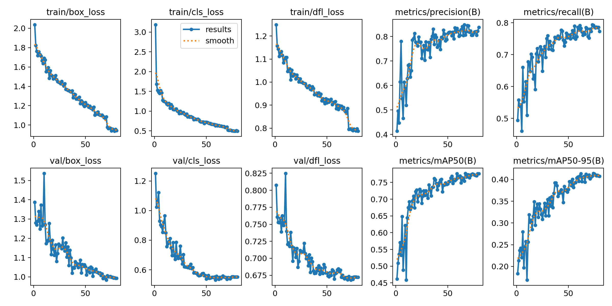
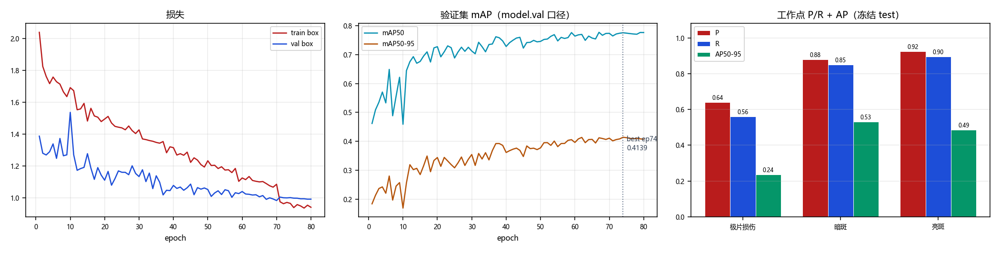

# `V5_GROUPED_1021_80ep` 训练结果与分析

> 本文件由 `scripts/archive_experiment.py` 依据 `runs/detect/CT_pro/V5_GROUPED_1021_80ep/` 与 `reports/eval/` 的真实文件生成，数字未经人工改写。
> 生成时间：2026-10-22 15:14

## 1. 配置

| 项 | 值 |
|---|---|
| 数据集 | `datasets_v5/CT_DATASET_V5_GROUPED/data.yaml` |
| 初始化权重 | `models/pretrained/yolov8n.pt` |
| 画布 imgsz | `1920` |
| 计划轮数 | `80` |
| batch | `0.75` |
| 优化器 | `AdamW` |
| lr0 | `0.001` |
| patience | `20` |

**数据增强（ultralytics 实际生效值）**

| mosaic | close_mosaic | degrees | translate | scale | shear | perspective | flipud | fliplr | hsv_h | hsv_s | hsv_v | erasing | copy_paste | mixup | cutmix | cls_pw |
|---|---|---|---|---|---|---|---|---|---|---|---|---|---|---|---|---|
| 1.0 | 10 | 5.0 | 0.05 | 0.05 | 0.0 | 0.0 | 0.0 | 0.5 | 0.0 | 0.0 | 0.1 | 0.4 | 0.0 | 0.0 | 0.0 | 0.0 |

## 2. 训练过程

| 项 | 值 |
|---|---|
| 实际完成轮数 | 80 / 80 |
| 最优 epoch | 74 |
| 最优 mAP50 / mAP50-95 | 0.7754 / **0.4139** |
| 总训练时长 | 3.32 h（149.4 s/epoch） |
| 末轮 train / val box_loss | 0.942 / 0.993 |
| 泛化间隙 (val-train)/train | +5.4% |

## 3. 冻结 test 评测

口径：`全图@1920`（layer1 走 model.val，固定 conf=0.001）；工作点 conf=0.25 / IoU=0.5。

| 报告 | mAP50 | mAP50-95 | FP/千张 | 组级漏检 | 单张耗时 |
|---|---|---|---|---|---|
| `V5_80ep_v5test` | 0.8028 | 0.4186 | 88.8 | 45/170 (26.47%) | 13.4 ms |
| `V5_at2112` | 0.7826 | 0.4238 | 122.8 | 42/170 (24.71%) | 15.5 ms |

**分类别（工作点 P/R + AP）**

| 类别 | AP50 | AP50-95 | P | R | TP | FP | FN |
|---|---|---|---|---|---|---|---|
| 极片损伤 | 0.5868 | 0.2363 | 0.6406 | 0.5616 | 41 | 23 | 32 |
| 暗斑 | 0.8780 | 0.5326 | 0.8805 | 0.8504 | 199 | 27 | 35 |
| 亮斑 | 0.9436 | 0.4869 | 0.9237 | 0.8963 | 121 | 10 | 14 |

电芯级漏检（抽样 n=10）：20%

## 4. 工作点扫描（conf 敏感度）

| conf | P | R | F1 | FP/千张 | 组级漏检 |
|---|---|---|---|---|---|
| 0.05 | 0.6833 | 0.8688 | 0.7649 | 263.3 | 20.00% |
| 0.10 | 0.7748 | 0.8484 | 0.8099 | 161.2 | 22.94% |
| 0.15 | 0.8146 | 0.8348 | 0.8246 | 124.3 | 24.12% |
| 0.20 | 0.8360 | 0.8303 | 0.8331 | 106.5 | 24.71% |
| 0.25 | 0.8575 | 0.8167 | 0.8366 | 88.8 | 26.47% |
| 0.30 | 0.8701 | 0.8032 | 0.8353 | 78.4 | 28.82% |
| 0.35 | 0.8814 | 0.7738 | 0.8241 | 68.0 | 33.53% |
| 0.40 | 0.8921 | 0.7670 | 0.8248 | 60.7 | 34.12% |
| 0.50 | 0.9248 | 0.7511 | 0.8290 | 39.9 | 35.88% |

## 5. 结论与判断（人工填写）

<!-- ARCHIVE-NOTES-START -->
_待补充：本 run 相对基线的净收益/净损失、可信度、是否可上线、遗留风险。_
<!-- ARCHIVE-NOTES-END -->

## 6. 产物清单

| 目录 | 内容 |
|---|---|
| `01_train/` | args.yaml、results.csv、results.png、曲线、混淆矩阵、batch 预览、train.log、`_train_meta.json` |
| `02_eval/` | 冻结 test 报告 JSON、conf 扫描 JSON、单 run 概览图 |
| `00_meta.json` | 本 run 的结构化摘要（供脚本与索引消费） |
| `weights/` | 不复制；见 `weights.txt` 记录的原路径与 md5 |
