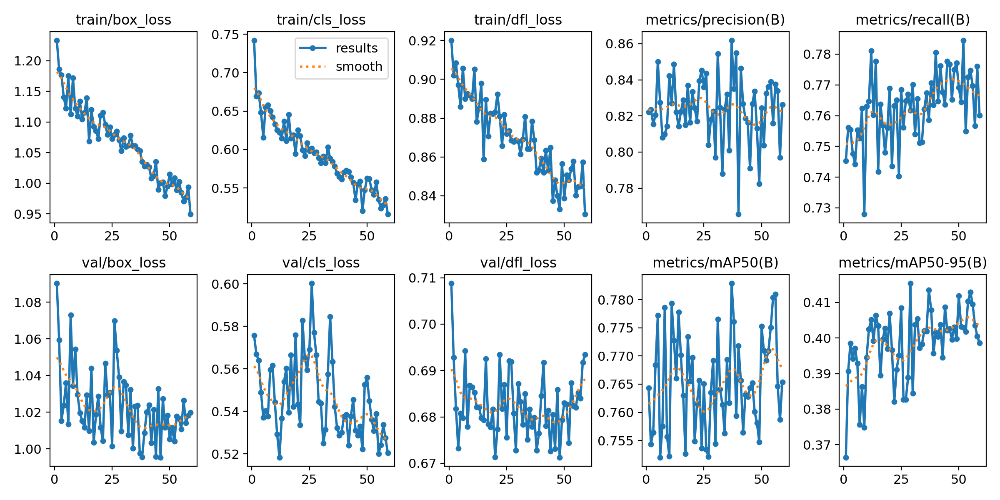
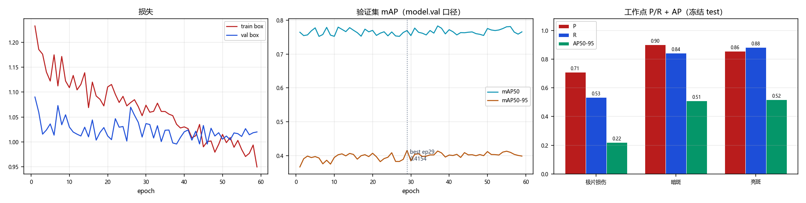

# `V5_GROUPED_1021_resume120` 训练结果与分析

> 本文件由 `scripts/archive_experiment.py` 依据 `runs/detect/CT_pro/V5_GROUPED_1021_resume120/` 与 `reports/eval/` 的真实文件生成，数字未经人工改写。
> 生成时间：2026-10-22 15:14

## 1. 配置

| 项 | 值 |
|---|---|
| 数据集 | `datasets_v5/CT_DATASET_V5_GROUPED/data.yaml` |
| 初始化权重 | `runs/detect/CT_pro/V5_GROUPED_1021_80ep/weights/best.pt` |
| 画布 imgsz | `1920` |
| 计划轮数 | `120` |
| batch | `0.75` |
| 优化器 | `AdamW` |
| lr0 | `0.0003` |
| patience | `30` |

**数据增强（ultralytics 实际生效值）**

| mosaic | close_mosaic | degrees | translate | scale | shear | perspective | flipud | fliplr | hsv_h | hsv_s | hsv_v | erasing | copy_paste | mixup | cutmix | cls_pw |
|---|---|---|---|---|---|---|---|---|---|---|---|---|---|---|---|---|
| 1.0 | 10 | 5.0 | 0.05 | 0.05 | 0.0 | 0.0 | 0.0 | 0.5 | 0.0 | 0.0 | 0.1 | 0.4 | 0.0 | 0.0 | 0.0 | 0.0 |

## 2. 训练过程

| 项 | 值 |
|---|---|
| 实际完成轮数 | 59 / 120（早停） |
| 最优 epoch | 29 |
| 最优 mAP50 / mAP50-95 | 0.7692 / **0.4154** |
| 总训练时长 | 2.40 h（146.4 s/epoch） |
| 末轮 train / val box_loss | 0.949 / 1.020 |
| 泛化间隙 (val-train)/train | +7.4% |

## 3. 冻结 test 评测

口径：`全图@1920`（layer1 走 model.val，固定 conf=0.001）；工作点 conf=0.25 / IoU=0.5。

| 报告 | mAP50 | mAP50-95 | FP/千张 | 组级漏检 | 单张耗时 |
|---|---|---|---|---|---|
| `V5_resume120_v5test` | 0.7787 | 0.4165 | 85.8 | 49/170 (28.82%) | 13.3 ms |

**分类别（工作点 P/R + AP）**

| 类别 | AP50 | AP50-95 | P | R | TP | FP | FN |
|---|---|---|---|---|---|---|---|
| 极片损伤 | 0.5543 | 0.2213 | 0.7091 | 0.5342 | 39 | 16 | 34 |
| 暗斑 | 0.8564 | 0.5113 | 0.8995 | 0.8419 | 197 | 22 | 37 |
| 亮斑 | 0.9255 | 0.5170 | 0.8561 | 0.8815 | 119 | 20 | 16 |

电芯级漏检（抽样 n=10）：20%

## 5. 结论与判断（人工填写）

<!-- ARCHIVE-NOTES-START -->
_待补充：本 run 相对基线的净收益/净损失、可信度、是否可上线、遗留风险。_
<!-- ARCHIVE-NOTES-END -->

## 6. 产物清单

| 目录 | 内容 |
|---|---|
| `01_train/` | args.yaml、results.csv、results.png、曲线、混淆矩阵、batch 预览、train.log、`_train_meta.json` |
| `02_eval/` | 冻结 test 报告 JSON、conf 扫描 JSON、单 run 概览图 |
| `00_meta.json` | 本 run 的结构化摘要（供脚本与索引消费） |
| `weights/` | 不复制；见 `weights.txt` 记录的原路径与 md5 |
